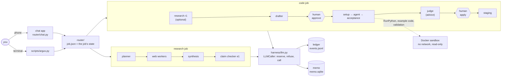
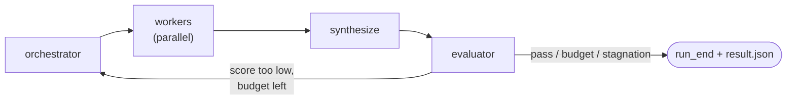

# Argus

Agent harness on LangGraph with a budget, a ledger and crash-resume on every model call. The pipelines in use are the
code job and the research job (`scripts/argus.py code` / `research`); see `AGENTS.md` for their stages.

**Two entry points, do not mix them up.** `scripts/argus.py` runs the real pipelines (the code job, the research job, the PRD
writer, the chat). `main.py` runs a small demo graph on fake nodes: it is the reference for the budget and crash-resume tests, not a
production path. Quick start for each is [below](#quick-start).

Direction (2026-11-15): a specialist in its properties, a generalist on its surface. Argus aims to be an agent you can leave
alone: its work is proven and its cost is locked. The guarantees below are that core; the chat (`scripts/argus.py chat serve`,
`router/chat.py`) is the one door through which capabilities are added, one at a time. Status: `docs/Reconciliation.md`;
open work: `PENDING.md`.

Of the guarantees below, the iteration rule is the demo graph's; the per-request, ledger and crash-resume ones hold on every
pipeline.

## How it fits together

Every model call of every pipeline passes through one place (`harness/llm.py`), which reserves the budget first and writes the
ledger around the call. What a stage finished is committed to the memo and never bought twice. Code the model writes runs only in
the Docker sandbox.

```text
you --phone----> chat app (router/chat.py) --+
you --terminal-> scripts/argus.py -----------+
                                             v
                      router/  (job.json = the state of the job)
             +-----------------+-------------------+
             v                                     v
   CODE JOB                                 RESEARCH JOB
   research r1 (optional)                   planner
        v                                        v
   drafter                                  web workers
        v                                        v
   [you approve]                            synthesis
        v                                        v
   setup > agent > acceptance               claim checker e1
        v
   judge (advice)
        v
   [you apply]
        v
   staging

every model call of every stage:
   harness/llm.py  LLMCaller: reserve > refuse if it does not fit > call
        |-----> ledger  events.jsonl (before and after each call)
        '-----> memo    memo.sqlite   (a committed result is never bought twice)

code the model writes (RunPython, example code, validation)
   '-----> Docker sandbox: no network, read-only
```

<details><summary>The same as a Mermaid diagram (GitHub's web page draws it; the phone app shows the code)</summary>



</details>

The demo graph (`graph.py`, run by `main.py`) is a different, smaller thing: an orchestrator plans, workers run in parallel,
synthesize writes the report, and the evaluator scores it; the loop stops on pass, budget or stagnation.

```text
orchestrator > workers (parallel) > synthesize > evaluator
      ^                                              |
      '------ score too low, budget left ------------'
evaluator: pass, budget or stagnation > run_end + result.json
```

<details><summary>Mermaid version</summary>



</details>
## Quick start

    pip install -r requirements.txt

### 1. The demo (`main.py`): no keys, no cost

The M1–M3 demo graph on a sales report, fake nodes by default.

    python main.py --scenario fail_then_pass        # pass | fail_then_pass | never_pass | flaky
    python -m pytest -q

Reproducible check from scratch (fresh venv, pinned versions, full suite): `bash scripts/verify.sh`

### 2. The real pipelines (`scripts/argus.py`): models, money and a sandbox

These need a provider key, a pinned sandbox image (see "Tools, path jail and sandbox") and a budget. Each command shows a
confirmation screen with the limits before anything is spent.

    # a code job: a drafter writes the tests, you approve, an agent works in the sandbox, you apply the patch
    python scripts/argus.py code --repo /path/to/repo --commit <sha> --issue-file issue.md --max-usd 1.5 --environment <name>
    python scripts/argus.py list                    # jobs and their state
    python scripts/argus.py status <job>
    python scripts/argus.py approve <job> --sha <draft sha>    # then: judge, apply, stage (--help of each)

    # a research job: planner, web workers, synthesis, claim checker
    python scripts/argus.py research --question "..." --max-usd 1.0

    # the phone's chat app (127.0.0.1 only)
    python scripts/argus.py chat serve --port 8711

`python scripts/argus.py --help` lists every command. The stages of each pipeline are in `AGENTS.md`; the specs are in
`docs/reviews/`.

## What a run leaves behind

Every run writes `events.jsonl` (the ledger) and `result.json`. The result of the demo run `python main.py --scenario pass`:

```json
{
  "status": "DONE",
  "stop_reason": "",
  "iteration": 1,
  "tokens_used": 11500,
  "tokens_spent": 11500,
  "usd_billed": 0.0,
  "usd_complete": true,
  "llm_calls": 0,
  "llm_calls_unknown": 0,
  "budget_violations": 0,
  "events_skipped": 0
}
```

`tokens_used` is the accounted figure and `tokens_spent` what really ran (they differ only after a crash). `usd_complete: false`
means some call had no known price, so `usd_billed` is a lower bound. `llm_calls_unknown` counts calls that were started and never
answered (the process died mid-request); they are charged at their worst case.

One model call in the ledger of a real run (a PRD writer turn; only the main fields), written in integer nano-dollars:

```json
{"event": "llm_call_started", "call_id": "3bd961c069b1", "model": "openrouter:anthropic/claude-haiku-5.5", "est_input": 5178, "worst_usd_nano": 8709800}
{"event": "llm_call", "call_id": "3bd961c069b1", "status": "ok", "input_tokens": 4558, "output_tokens": 182, "usd_nano": 546800, "charged": "actual", "stop_reason": "tool_calls"}
```

The first line is written before the request with the worst case the reservation must cover; the second after it, with what
the provider billed. The same `call_id` ties them together.

## Budget guarantees

- **Tokens (hard):** an iteration starts only if its worst-case cost (`token_estimates`,
  orchestrator + `max_workers` workers + synthesize + evaluator) fits in what is left, so
  `tokens_used <= max_tokens` always. A node reporting more than its estimate raises
  `EstimateExceeded`; a plan wider than `max_workers` raises `PlanRejected`.
- **USD (hard):** same reservation rule with `budget.max_usd`; each node's worst case is its token
  estimate at the dearer of its model's input/output rate (times the peak multiplier). Models without a
  price are refused unless `budget.allow_unpriced: true`.
- **Per request (harness/llm.py):** every model call goes through `LLMCaller`. It counts input tokens
  over the whole context (content, assistant tool calls and their arguments, tool results, tool schemas),
  sets `max_tokens` to what is left of the node's reservation in tokens and USD, and refuses before
  sending when that is below `llm.min_output_tokens`. SDK-internal retries are disabled so no attempt
  escapes the ledger.
- **How hard is the cap?** With an exact counter (Anthropic) charges cannot exceed the reservation.
  With a heuristic counter (OpenAI, DeepSeek) the cap holds against an estimate with a margin: if a
  provider bills more input than estimated and the node goes over, that is a `budget_violation`, logged,
  further calls are refused, and the run ends `FAILED_BUDGET`. Detected and reported, but **not an
  absolute financial cap**.
- **Unpriced models** are refused whenever `max_usd` is finite (`allow_unpriced` only applies with
  `max_usd: null`). Their cost is recorded as unknown (`null`) per call, never as $0. A run's total `usd_billed` is then the sum of the
  priced calls only (a lower bound), and `result.json` shows `usd_complete: false`. Whatever adds costs up (the eval
  runner, `scripts/run_series.py`) treats a run whose `usd_billed` is missing, or whose `usd_complete` is not true, as
  unknown, stops, and reports the amount as a lower bound, never as a total.
- **Ledger lifecycle:** `llm_call_started` (with a `call_id` and the worst case) is written before each
  request, the final `llm_call` after it, and only then is the reservation charged (even if writing the
  ledger fails). A started call with no final event, because the process died mid-request, is
  reconciled as `unknown_after_crash` at worst case (`reconcile_ledger`, `llm_calls_unknown` in
  `result.json`). Errors record `delivery`: `received` (the provider answered with a status) or
  `unknown` (timeout or connection error: it may or may not have been processed or billed).
- Money is accounted in **integer nano-dollars** (`usd_nano`), so the ledger and the reservations sum
  exactly. `meta` passed to a call is limited to `run_id, node, task, iteration, step, tool_call_id`.
- **Iterations (hard):** checked before each iteration.
- **Time (soft):** `max_seconds` is the sum of node run times (parallel workers add up),
  checked between iterations only. It does not interrupt a running node.
- **Stagnation:** a score that is equal or lower than the best so far is a stale round;
  `stagnation_rounds` stale rounds in a row stop the run. Status priority: passed > budget > stagnation.
- Every run ends with a `run_end` event and `result.json` carrying `status` and `stop_reason`.

## Crash-resume guarantees

Against a hard crash, "exactly once" is impossible: work can finish and the process can die before
its result is saved. What the harness guarantees (tested, including 50 parallel-worker crashes):

1. The resumed run ends with the same outcome and the same `tokens_used` as an uninterrupted run.
2. A node run whose result was committed to the memo (`result_committed`) is never performed again;
   if LangGraph schedules it again, the memo answers (`memo_hit`).
3. Work is redone only when it had no committed result at the crash: a node still running, or one
   that finished in the short window before its commit. `tokens_spent` in `result.json` (sum of
   `body_done` events) shows that real extra spend; `tokens_used` stays the accounted figure.

Inside an agent loop (LLM worker, phase 2c) the same holds **per step**: each model reply and each
tool result is committed to the memo before the loop moves on, keyed by the step's input identity
(messages so far, tool schemas, model; tool steps also by their requesting LLM step and the tool's
version). On resume, committed steps are replayed with zero model calls and zero tool runs, and a
changed instruction, feedback, model or tool version never reuses an old entry. A node run's
reservation is restored from the ledger after a crash, so its limit holds across processes.

Consequence for real tools: anything with side effects (files, messages, payments) must be safe to
run twice for the same `(node, task, iteration)`, e.g. write to a temp file and rename.

Simulate crashes yourself: `python main.py --crash-at worker`, or `--crash-at worker@after_commit`,
then the same command with `--resume`. A fresh run refuses an existing `--run-id`.
Inside nodes: `orchestrator@after_llm`, `worker@after_llm` (reply not yet committed),
`worker@llm_committed`, `worker@tool_committed`.

## Node implementations

`impl` in `config.yaml` picks each node's implementation: `fake` (deterministic, no model calls) or
`llm` (real model through `harness/llm.py`). Per run: `--impl orchestrator=llm`.

Try the LLM orchestrator offline with the scripted `fake` provider:

    ARGUS_FAKE_SCRIPT=script.json python main.py --impl orchestrator=llm --model orchestrator=fake:scripted

where `script.json` is a list of replies, e.g. `[{"tool_calls": [{"name": "SubmitPlan", "args": {...}, "id": "p1"}]}]`.
See `tests/test_orchestrator_llm.py` for complete plans. `--config other.yaml` runs with another config file.

## Tools, path jail and sandbox

- **File tools** go through `tools/fs.py` (`PathJail`): paths are relative to an allowed root; absolute
  paths, `..` above the root and NUL bytes are refused. No symlink is followed anywhere below the
  root: each directory is opened with `openat(O_DIRECTORY|O_NOFOLLOW)` relative to its already-opened
  parent and the file relative to its directory's descriptor, so swapping a parent directory for a
  symlink mid-operation cannot redirect it outside. Only regular files are read. Writes are atomic
  (temp, fsync, `renameat`, fsync of the directory) and safe to repeat. The report is written inside
  the run directory only.
- **Path jail threat model:** holds against any path from the model and against a concurrent local
  process modifying directories *inside* the root (e.g. sandboxed code writing in its workspace).
  Not covered: an attacker who can change the root path or anything above it (trusted configuration).
- **`RunPython`** (LLM workers) runs in Docker (`tools/sandbox.py`): no network, read-only root fs,
  user nobody, no capabilities (bounding set empty), `no-new-privileges`, memory/CPU/pids limits,
  only `/workspace/<task>` writable, data read-only, wall-clock timeout that kills and removes the
  container. There is **no unsandboxed fallback**. Enable with `sandbox.kind: docker`.
- **Output is bounded on the host:** stdout and stderr are drained in chunks; the harness keeps at most
  `max_output_bytes` per stream and discards the rest (it never stops reading, so the code cannot
  block on a full pipe). Past `kill_after_output_bytes` in total the container is killed early.
  Container logging is off (`--log-driver none`), so output is never copied to the host disk either.
- **Cleanup is bounded:** after a timeout or output flood, kill/remove/waits share one
  `cleanup_timeout_s` budget, so a hung Docker daemon cannot stretch a call much past
  `timeout_s + cleanup_timeout_s`. Removal is confirmed with `docker ps`; if it cannot be confirmed the
  result has `cleanup_failed: true` and a `sandbox_cleanup_failed` event names the container.
- The image must be **pinned** (`name@sha256:...` or an image id). On a machine with registry access:
  `bash scripts/pin_sandbox_image.sh` (writes `.sandbox_image`). Without registry access:
  `bash scripts/build_local_sandbox_image.sh` (builds one from the local python3 with `docker import`).
  The pinned image is part of the RunPython tool version, so a new image never reuses memo results.
- `tests/test_sandbox.py` checks each flag's effect from inside a real container (mounts, CapBnd,
  cgroup limits, OOM kill, fork bomb, timeout cleanup). Skipped sandbox tests make `verify.sh` FAIL
  unless `ARGUS_SANDBOX_OPTIONAL=1`.

## Providers and models

Everything lives in `config.yaml` (`providers`, `roles`, `prices`).

- Set keys as environment variables: `ANTHROPIC_API_KEY`, `OPENAI_API_KEY`, `DEEPSEEK_API_KEY`. Never put keys in files.
- Swap a model for one run: `python main.py --model worker=deepseek:deepseek-flash`
- Swap permanently: edit `roles.<role>.model` in `config.yaml`.
- Add an OpenAI-style provider: add an entry with `kind: openai_compatible` and a `base_url`. No code.
- Add a brand-new kind of provider: `@register_kind("name")` in `models/registry.py`.

## Verify against the real APIs (needs your keys)

    python scripts/smoke_models.py                  # key, model id, chat, tool calling, cost per role
    python scripts/smoke_models.py --list --grep gpt   # which model ids the provider really offers

The OpenAI model id in `config.yaml` is a placeholder: confirm it with `--list` before trusting it.
Prices are public figures from mid-Oct 2026; an empty price means cost shows as n/a.

## Notes

- DeepSeek charges 2x on weekdays 01-04 and 06-10 UTC (08-11 and 13-17 WIB); `models/pricing.py` models this.
- Checkpoints use `durability="sync"` so a hard crash does not lose the last step.
